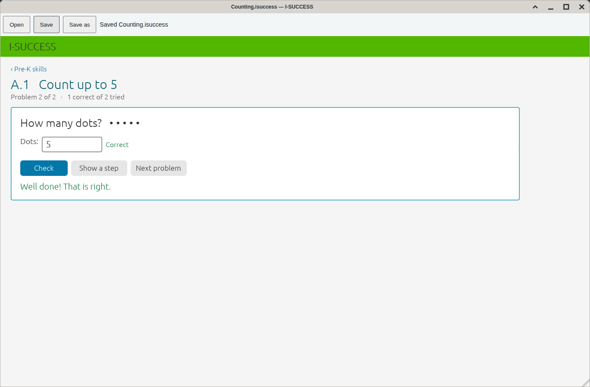

# I-SUCCESS for browsers

This crate renders the native egui curriculum and practice engine with WebGL. The WebOS host opens and saves UTF-8 TOML practice documents with the .isuccess extension. A document records the selected skill, problem, answers, worked steps and score. It has no account identifier. The browser build uses a text heading in place of the native brand artwork.



Use the project's pinned Rust toolchain with the wasm32-unknown-unknown target and wasm-bindgen CLI 0.2.130.

```sh
python3 apps/i-success-web/build.py /new/output/directory
```

The generated module exports PracticeWindow. Call start with a canvas, document to serialize the current window, load to restore it, and close when the view is removed. Load validates the document against the embedded curriculum before replacing the current session.
